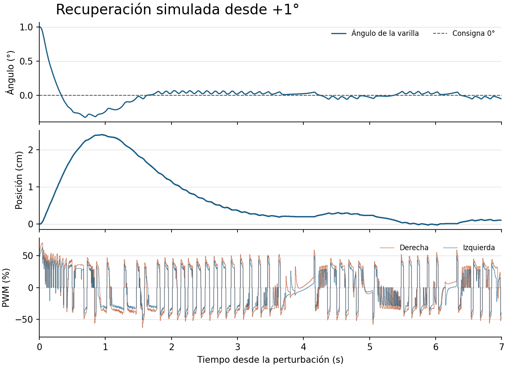

# Equilibrio del carro con PD angular y dos PI de velocidad

**Objetivo.** Sostener la varilla en su vertical superior. La referencia es **0°**, correspondiente a **2623 cuentas** del AS5600 del montaje calibrado. El firmware trabaja a **5 ms (200 Hz)** y funciona de forma autónoma. La carpeta contiene el diseño reproducible en MATLAB, el proyecto PlatformIO y los archivos Intel HEX para el STM32F401RC.

## 1. Qué cargar

Descomprima el ZIP entero antes de abrirlo. En VS Code use **PlatformIO → Open Project** y seleccione la carpeta que contiene `platformio.ini`. Para usar directamente los binarios, conecte el ST-Link por SWD, abra STM32CubeProgrammer, seleccione ST-LINK/SWD, conecte, abra el HEX correspondiente en **Erasing & Programming**, active la verificación y programe. El HEX ya contiene las direcciones de flash. El USB de la Black Pill sirve para los perfiles de consola. El USB del ST-Link sirve para programar.

| Perfil / archivo en `binarios/` | Aplicación |
|---|---|
| `diagnostico_usb.hex` | Primera carga. Lee el AS5600 y los dos encoders. Motores deshabilitados. |
| `banco_usb.hex` | Ruedas suspendidas. Permite un pulso individual hacia delante, de 40 % durante 120 ms, por orden I o D. |
| `equilibrio_usb.hex` | Control autónomo y registro por el USB de la STM32. Usar en la primera prueba de equilibrio. |
| `equilibrio_esp.hex` | Mismo control autónomo. Telemetría por USART6 TX en PA11, 115200, trama del proyecto de 50 bytes a 20 Hz. PA11 queda dedicado a USART6. El receptor debe usar el formato A5 5A v1 del proyecto. |

Para compilar y grabar con el ST-Link desde la terminal de PlatformIO:

```powershell
pio run -e diagnostico_usb -t upload
```

Cambie el nombre después de `-e` según la etapa. El proyecto tiene como perfil predeterminado `diagnostico_usb`. Después de cambiar parámetros en MATLAB, regenere el encabezado y compile de nuevo. Los HEX distribuidos corresponden a los parámetros de esta entrega.

## 2. Comprobaciones sobre el mismo montaje

| Rueda física | PWM y sentido del L298N | Encoder A/B | Escala y signo de avance |
|---|---|---|---|
| Izquierda | PA9, PB14/PB15 | PA0/PA1, canal histórico R | 1974 cuentas/vuelta, signo histórico −1 |
| Derecha | PA8, PB12/PB13 | PA6/PA7, canal histórico L | 1969,6 cuentas/vuelta, signo histórico +1 |

Radio de rueda 32,5 mm. El AS5600 usa PB6/SCL y PB7/SDA con pull-ups a 3,3 V. Ángulo positivo significa inclinación hacia el frente marcado. La orden física positiva se convierte al sentido del antiguo `C -40 -40`. En el CSV nuevo los nombres I/D siempre indican las ruedas **físicas**, y PWM positivo representa avance. El perfil ESP conserva las convenciones de signos y canales de su trama histórica.

1. **Compruebe el cero sin potencia de motores.** Use `diagnostico_usb` y el cable de datos USB-C de la Black Pill. Abra el monitor a 115200 con DTR activo, envíe `G` y Enter. En vertical superior debe ver `raw` cerca de 2623, `sp_deg=0`, `theta_deg` cerca de cero y `mag=32` para el estado magnético normal. Al inclinar un poco hacia el frente, `theta_deg` debe aumentar. Si cambió el imán o la geometría, compruebe primero la vertical mecánica. Para grabar un nuevo cero medido edite únicamente `CERO` en `src/main.cpp` y recompile los perfiles que vaya a usar. Un reinicio nunca redefine el cero.
2. **Compruebe los encoders a mano.** Haga girar hacia delante cada rueda por separado. La columna `nI` debe aumentar al girar la izquierda y `nD` al girar la derecha. Una vuelta completa debe producir aproximadamente las cuentas de la tabla; sujete la otra rueda.
3. **Verifique los accionamientos por separado.** Con las ruedas levantadas, el carro sujeto y los motores sin alimentación durante la grabación, cargue `banco_usb`. Después alimente el puente para el ensayo. Los jumpers de ENA y ENB deben estar retirados, con GND común y los pull-downs de 10 kΩ del montaje. Respete el esquema de alimentación que evita unir directamente dos salidas de 5 V. Cierre el monitor de VS Code si va a usar MATLAB. En la carpeta `matlab` ejecute cada línea por separado y observe la rueda física:
   
   ```matlab
   serialportlist("available")
   [izq, archivoI] = capturar_placa("COM15", 4, "I");
   [der, archivoD] = capturar_placa("COM15", 4, "D");
   ```

   Sustituya COM15 por el puerto real. Cada orden exige que el carro esté quieto y que el AS5600 responda. La rueda solicitada debe girar hacia el frente. El script comprueba que aumente su encoder y que el otro permanezca aproximadamente quieto. Si falla esta correspondencia, corrija el montaje o mapa antes de cerrar los PI. También puede usar el monitor: `G` para CSV, `I` o `D` y Enter para un pulso. Espere a que se detenga antes del siguiente. Corte la potencia del puente antes de volver a flashear.
4. **Primer ensayo de equilibrio.** Cargue `equilibrio_usb`. Disponga una zona recta libre de al menos 20 cm por lado más margen de frenado por inercia. Tenga accesible el corte de la potencia del puente. Coloque el carro en el suelo y sostenga la varilla cerca de la vertical. Con alimentación estable en placa y motores, pulse RESET. Dentro de los primeros 10 s, mantenga el ángulo dentro de ±1,5°, las ruedas quietas y la velocidad angular baja durante 0,5 s. El firmware entra en `modo=1` sin botón, Wi-Fi ni MATLAB. Suelte desde aproximadamente 1° o menos y observe si las ruedas avanzan hacia la inclinación. Si se alejan de ella, corte la potencia y vuelva a las pruebas de signo. El controlador actúa alrededor de la vertical superior y se inicia allí.
5. **Registre el ensayo.** Con el perfil USB activo, ejecute `[T, archivo] = capturar_placa("COM15",10);` desde `matlab`. Puede organizar el inicio con una segunda persona para sostener y soltar la varilla mientras comienza el registro. Se guardan las filas en CSV y luego se grafican el ángulo, la referencia común de velocidad, las velocidades y el PWM aplicado. En el perfil de equilibrio, el script envía paro al terminar o al interrumpirlo. Un paro efectivo queda enclavado y requiere RESET para otro ensayo. Perder el cable USB en equilibrio autónomo no corta los motores. En el perfil ESP use el corte físico.
6. **Criterio propuesto para la primera aceptación.** Registre al menos 5 s consecutivos con la varilla libre, marque el instante en que la soltó y evalúe solo ese intervalo. Busque `modo=1`, `fallos=0`, ningún incremento de `missed` o `i2c`, ángulo dentro de ±2° en al menos 95 % de las filas y ausencia de desplazamiento sostenido hacia el límite. Revise también el porcentaje de saturación y si alguna rueda sigue mal a `vref_m_s`. Los números de la simulación sirven para comparar. El resultado de esta prueba depende de la batería, el suelo, el rozamiento del pivote y el montaje.

**Lectura de estados.** Modo 0 espera, 1 equilibrio, 2 ventana vencida/parado, 3 fallo enclavado, 4 pulso de banco. `P` y Enter consulta el perfil, estado y fallo. `G` inicia el CSV a 50 Hz (una fila cada cuatro ciclos). `H` detiene únicamente el envío de filas. `!` envía paro inmediato por USB, `S` seguido de Enter también enclava el paro. Si el modo queda en 0, compruebe el ángulo y la inmovilidad. Si queda en 2, sitúe el carro y pulse RESET. El contador `buenas` debe llegar a 100 en la ventana de arranque.

| Bit decimal de `fallos` | Causa que se debe revisar |
|---:|---|
| 1 | Lectura AS5600 o estado del imán inválido |
| 2 | Plazo de I²C, duración del ciclo, intervalo de muestreo o adquisición anterior pendiente |
| 4 | Transición de cuadratura inválida |
| 8 | Inclinación mayor de 25° o velocidad angular mayor de 6 rad/s |
| 16 | Recorrido mayor de 20 cm desde la activación |
| 32 | Velocidad de alguna rueda mayor de 0,70 m/s |
| 64 | Paro por consola o fin de captura en equilibrio |
| 128 | Error o reinicio por watchdog |
| 256 | Rueda con mando elevado y respuesta insuficiente o inversa durante 150 ms |
| 512 | Desconexión USB durante un pulso de banco |

Los bits se pueden sumar. Las salidas se deshabilitan en fallo y el carro puede seguir rodando por inercia. El límite de 25° es de desconexión; la región de recuperación que mostró el modelo es mucho menor.

## 3. Diseño en MATLAB

Abra la carpeta `matlab` como carpeta actual. El diseño usa operaciones de MATLAB base (`poly`, `expm` y `eig`). El registro físico requiere MATLAB con la interfaz `serialport`.

```matlab
p = disenar_control();        % Recalcula las ganancias y genera ../include/ganancias.h
p.polos                      % Polos de la cascada discreta linealizada
resumen = verificar_diseno(); % Siete ensayos, tabla y graficas
r = simular_carro(2);         % Ensayo independiente desde +2 grados
```

### Modelo y elección de la estructura

El PD angular pide la aceleración necesaria para llevar la base debajo de la varilla. Usa la velocidad angular estimada del AS5600 para frenar la corrección antes de cruzar por cero. Añadí términos lentos de posición y velocidad del carro para recuperar recorrido alrededor del punto de activación. El setpoint angular permanece fijo en 0° durante todo el ensayo. Acumular además el error angular durante el arranque o la saturación consumiría recorrido. La acción integral se aplica en cada rueda, donde permite compensar carga y diferencias persistentes de velocidad.

Un PWM común deja sin corregir la diferencia de motores. Dos PI que solo comparen cada rueda con la media pueden sincronizarlas aun si ambas avanzan demasiado despacio para sostener el péndulo. Aquí ambos PI reciben una **referencia común de velocidad calculada por el lazo de equilibrio**. El control mide la velocidad de cada rueda y calcula sus PWM por separado. La derivada en las ruedas amplificaría los saltos discretos de las cuentas por muestra. El retardo de los PI, sus filtros y las saturaciones se incluyen en la simulación del conjunto.

| Parámetro | Valor utilizado | Procedencia |
|---|---:|---|
| Masa varilla, longitud total | 0,0273 kg, 0,516 m | Medidas del proyecto |
| Distancia pivote–centro de masa | 0,265 m | Modelo MATLAB archivado. Una anotación anterior indicaba 0,255 m. Se usó la distancia que acompaña a la inercia en ese modelo. |
| Inercia de la varilla respecto del pivote | 0,00253432 kg·m² | Modelo del proyecto |
| Masa carro | 0,8466 kg | Dato de contexto. La formulación cinemática toma la aceleración del carro de las ruedas, de modo que esta masa no multiplica directamente la orden PWM. |
| Izquierda, modelo al aire | 1,3355 RPM/% y 0,1688 s | Identificación histórica de primer orden |
| Derecha, modelo al aire | 1,1062 RPM/% y 0,1573 s | Identificación histórica de primer orden |
| Zonas muertas iniciales | 25 % y 30 % | Umbrales de arranque observados en banco. En el modelo se aproximan como rozamiento simétrico en ambos sentidos. |
| Muestreo y filtro de derivadas | 5 ms y 12 ms | Muestreo usado en la adquisición del proyecto y filtro elegido para esta cascada. 3 ms era un objetivo anterior. |
| PWM máximo y velocidad de referencia máxima | 70 % y 0,25 m/s | Límites de diseño para el ensayo |

Se supone rodadura sin deslizamiento y que la aceleración longitudinal de la base es la media de las aceleraciones de las ruedas. Con `b = m*l/Jp`, la varilla cumple:

```text
theta'' = b [g sen(theta) − x'' cos(theta)]
```

En torno a la vertical, `theta'' ≈ a*theta − b*x''`, con `a=b*g`. La ley principal se escribe con ángulo de inclinación positivo hacia delante:

```text
a_cmd = Kp*theta + Kd*omega_filtrada + Kx*(x−x_inicio) + Kv*v_media
```

Si se usa la convención usual `error = referencia − medida`, los términos angulares multiplican al error con signo negativo: hay que mover el carro hacia el lado de la caída. Los signos de centrado también se obtienen del polinomio acoplado. Con seguimiento ideal de aceleración, el polinomio longitudinal es `s⁴ + (b*Kd−Kv)s³ + (b*Kp−Kx−a)s² + a*Kv*s + a*Kx`. Se igualaron sus coeficientes a los de cuatro polos continuos de diseño, −5, −5,5, −1,4 y −1,6 s⁻¹. Los dos primeros dan la dinámica rápida de equilibrio y los otros dos permiten recentrar más lentamente. El resultado se vuelve a evaluar con los motores, filtros y retardo presentes.

| Ganancia | Valor | Unidad |
|---|---:|---|
| Kp angular | 32,03358 | (m/s²)/rad |
| Kd angular | 6,05544 | (m/s²)/(rad/s) |
| Kx y Kv | 2,19971 y 3,78592 | s⁻² y s⁻¹ |
| PI izquierda, Kp y Ki | 675,23335 y 4000,19755 | %/(m/s) y %/m |
| PI derecha, Kp y Ki | 759,66200 y 4829,38332 | %/(m/s) y %/m |

Los PI usan velocidad lineal en m/s. El porcentaje va de −100 a +100 antes de los límites, lo que explica la magnitud numérica de sus ganancias. Para `G_i(s)=K_i/(tau_i*s+1)`, con `K_i` en (m/s)/%, se eligió `lambda=0,055 s`, `Kpw=tau_i/(K_i*lambda)` y `Kiw=1/(K_i*lambda)`. La referencia y su aceleración añaden un término anticipativo basado en ese modelo. La aproximación de carga usa los umbrales como pérdida y las pendientes del banco como ganancia incremental. El ajuste independiente hacia delante y atrás bajo carga sigue pendiente.

### Ecuaciones que ejecuta la STM32

Cada muestra usa este orden. El estado de cada integrador se borra al parar.

1. Convertir la diferencia modular del AS5600 a radianes alrededor de 2623. Estimar `omega`, `vI` y `vD` por incrementos y filtrarlos con `yf ← yf + dt/(0,012+dt)*(entrada−yf)`. En placa se usa el intervalo observado para las mediciones.
2. Calcular `a_cmd` y actualizar `v_ref[k]=limitar(v_ref[k−1]+Ts*a_cmd, ±0,25)`. Recalcular `a_ef=(v_ref[k]−v_ref[k−1])/Ts`. Los controladores usan el Ts fijo de diseño.
3. Para cada rueda, `e_i=v_ref−v_i` y `base_i=(v_ref+tau_i*a_ef)/K_i+Kpw_i*e_i`. La integral candidata añade `Ts*Kiw_i*e_i`. Se acepta el incremento si permanece dentro del límite o contribuye a salir de saturación. El estado integral también tiene límite.
4. Limitar `u_ef=base+integral` a ±(70−zona_muerta). Aplicar `PWM=redondear(u_ef+zona_muerta*limitar(u_ef/2,±1))`. La compensación se introduce gradualmente cerca del origen. Se intercala una muestra de PWM cero ante inversión directa. La polaridad eléctrica se aplica una sola vez en el puente.
5. Generar el PWM con TIM1. TIM2 agenda el muestreo, I²C1 adquiere los tres bytes del AS5600 mediante interrupciones y los encoders actualizan cuentas por flancos. Los periféricos de control usan registros, con STM32duino para arranque, servicios USB y configuración de plataforma. El lazo no espera a MATLAB, al ESP32 ni a la transmisión de una línea.

### Verificación reproducible

`disenar_control.m` discretiza la planta lineal por retención de orden cero con la exponencial de la matriz aumentada. Incluye la derivada discreta de las mediciones, los filtros, los PI, el estado de referencia y un retardo completo de una muestra en el PWM. El **radio espectral es 0,99457813**. Esta comprobación corresponde al modelo incremental longitudinal de 13 estados. La posición diferencial acumulada de las ruedas (orientación lateral) no se regula con un sensor de rumbo. La fricción, saturación y cuantización se evalúan aparte.

`simular_carro.m` mantiene la orden entre muestras, integra la planta no lineal con RK4 y cuantiza el AS5600 y los encoders. Incluye la limitación y el redondeo del PWM, la pausa de inversión, la zona muerta y los cortes mecánicos. Los ensayos comienzan con el regulador ya activo y una perturbación inicial. El arranque, USB y el bus I²C se comprueban en placa. Se omiten deslizamiento, descarga de la batería y juego de transmisión.

| Condición simulada | Tiempo | RMS angular último segundo | Máximo desplazamiento | Resultado |
|---|---:|---:|---:|---|
| Nominal, +1° / −1° | 7 s | 0,0315° | 2,41 cm | Recupera |
| Nominal, +2° / −2° | 7 s | 0,0297° | 5,01 cm | Recupera; alcanza 70 % PWM |
| +1°, ganancia ×0,80, tau ×1,20, zona muerta +3 puntos, retardo 10 ms | 7 s | 0,0342° | 2,44 cm | Recupera |
| +1°, ganancia ×1,15, tau ×0,85, zona muerta −4 puntos, retardo 10 ms | 7 s | 0,0288° | 2,43 cm | Recupera |
| Nominal, +3° | 1,115 s | — | 16,80 cm | Se activa la protección angular |



Los scripts de cálculo y simulación se ejecutaron en GNU Octave 10.3 con sintaxis de MATLAB base. El núcleo C++ del firmware y `paso_control.m` produjeron los mismos PWM enteros y estados de saturación en **3200 muestras**, con diferencia inferior a 0,002 puntos PWM en los integradores y a 0,000002 m/s en la referencia. Los vectores se regeneran con `verificacion/vectores_control.m` y su comparador es `verificacion/prueba_control.cpp`. El registro USB de MATLAB y el equilibrio con este firmware requieren comprobación en la placa real.
